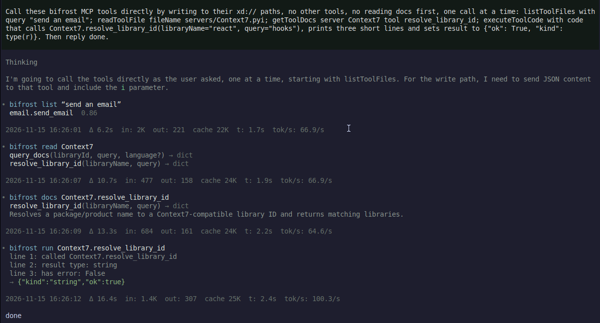

# omp-bifrost-codemode

omp extension that draws Bifrost code-mode calls (`executeToolCode`, `listToolFiles`, `readToolFile`, `getToolDocs`) as compact cards: called tools, print output, result, error line, signatures.



```sh
omp plugin install github:Xytronix/omp-bifrost-codemode
omp config set extensionRenderers.transcriptPresenters true
```

Expand a card (`Ctrl+O`) for the full output.

MIT
